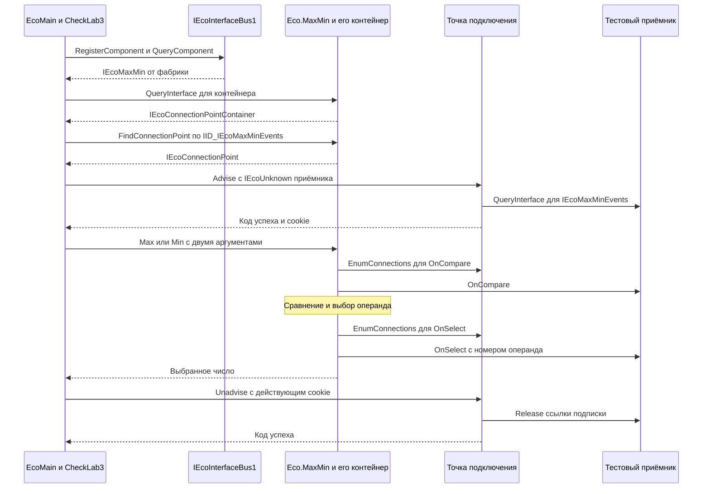

# Eco.MaxMin · техническая документация лабораторной №3

Вариант 26. Для проверки достаточно одной команды из [раздела «Быстрая проверка»](#2-быстрая-проверка). Результаты приёмки и проверок с намеренными поломками зафиксированы в [отчёте Word](Eco_MaxMin_Lab3_report.docx).

## 1. Задание и результат

Компонент ACOM **Eco.MaxMin** из первой лабораторной выбирает максимум или минимум из двух аргументов одного типа. Для каждого из пяти типов предусмотрены два метода. Лабораторная №3 добавляет одну точку подключения на экземпляр, один слот для приёмника и два синхронных события о вычислении. Консольный UnitTest показывает подписку, получение событий и повторный вызов после отписки. [Числовой интерфейс](SharedFiles/IEcoMaxMin.h#L19) · [Точка подключения](SourceFiles/CEcoMaxMinConnectionPoint.c#L286) · [Демонстрация в UnitTest](UnitTestFiles/SourceFiles/EcoMaxMin.c#L228)

По шкале задания работа демонстрирует признаки диапазона **6–7 баллов**: один экземпляр компонента, один приёмник, несколько видов событий и отчёт. В демонстрации используются два вида событий, `OnCompare` и `OnSelect`. [Контракт событий](SharedFiles/IEcoMaxMinEvents.h#L24) · [Отчёт Word](Eco_MaxMin_Lab3_report.docx)

Исходная база — проект первой лабы из `main`, коммит `c067516`. Для реализации использованы существующие исходники на C и схема точек подключения из лекции №5. Проект собирался на Mac с Apple Silicon через Makefile и Apple Clang в режиме C89. Шаблон Visual Studio 2010 не использовался. CID компонента, IID и таблица методов `IEcoMaxMin` сохранены. Для событий введён отдельный `IID_IEcoMaxMinEvents`. [Исходная база и способ сборки в отчёте](Eco_MaxMin_Lab3_report.docx) · [Makefile](AssemblyFiles/Mac/clang_arm64/Makefile#L27) · [CID](SharedFiles/IdEcoMaxMin.h) · [IID событий](SharedFiles/IEcoMaxMinEvents.h#L6)

## 2. Быстрая проверка

На Mac с Apple Silicon нужны Apple Command Line Tools и `Eco.Framework` с заголовками и статическими библиотеками для `Mac/arm64`. Из корня проекта выполните команду. Если Framework установлен в другом месте, подставьте его путь в `ECO_FRAMEWORK`.

```sh
make -C AssemblyFiles/Mac/clang_arm64 ECO_FRAMEWORK="$HOME/Downloads/Eco.Framework" test
```

Цель `test` проверяет наличие зависимостей, при необходимости собирает библиотеку и UnitTest, затем запускает UnitTest. При отсутствующей зависимости Makefile печатает `MISSING:` с путём к файлу. [Проверка окружения](AssemblyFiles/Mac/clang_arm64/Makefile#L46) · [Цель test](AssemblyFiles/Mac/clang_arm64/Makefile#L78)

Ожидаемый вывод UnitTest после строк сборки. Первый `PASS` относится к исходным вычислениям, второй — к точке подключения и событиям. При сбое команда завершится с ненулевым кодом. [Порядок запуска проверок](UnitTestFiles/SourceFiles/EcoMaxMin.c#L380) · [Фактический вывод в отчёте](Eco_MaxMin_Lab3_report.docx)

```text
PASS: 12 Eco.MaxMin UnitTest checks
MaxInt(-5, 9): OnCompare -> OnSelect(2) -> 9
MinInt(-5, 9): OnCompare -> OnSelect(1) -> -5
Lab 3: 30 numeric and event cases passed
After Unadvise: MaxInt(-5, 9) = 9, events = 0
Lab 3: 100 subscription cycles passed
PASS: Lab 3 connection point and event checks
```

| Файл после сборки | Путь от корня проекта |
| --- | --- |
| Статическая библиотека компонента | `BuildFiles/Mac/arm64/StaticRelease/lib48749720D2434B819DCFE025D17DEB17.a` |
| Исполняемый UnitTest | `BuildFiles/Mac/arm64/UnitTest/EcoMaxMin` |

Пути заданы в [переменных Makefile](AssemblyFiles/Mac/clang_arm64/Makefile#L7). Для чистой пересборки выполните обе команды по порядку. Цель `clean` удаляет каталог результатов `BuildFiles/Mac/arm64`. [Цель clean](AssemblyFiles/Mac/clang_arm64/Makefile#L81)

```sh
make -C AssemblyFiles/Mac/clang_arm64 clean
make -C AssemblyFiles/Mac/clang_arm64 ECO_FRAMEWORK="$HOME/Downloads/Eco.Framework" test
```

**Минимум в метаданных готовой сборки — macOS 26.0.** Поле `minos` команды загрузки Mach-O `LC_BUILD_VERSION` содержит `26.0` у ARM64 UnitTest и у всех трёх объектов библиотеки. **Проверенная система — macOS 26.7 на ARM64**, включая чистую сборку из каталога с пробелами в пути. На macOS ниже 26.0 нужна чистая сборка из исходников с совместимыми Apple Command Line Tools и Eco.Framework для `Mac/arm64`. Прогоны на macOS ниже 26.7 не проводились. [Требования к готовой сборке](README.md#сборка-и-проверка-на-mac) · [Отчёт о прогоне](Eco_MaxMin_Lab3_report.docx)

После сборки эти метаданные можно посмотреть из корня проекта:

```sh
vtool -show-build BuildFiles/Mac/arm64/UnitTest/EcoMaxMin
otool -arch arm64 -l BuildFiles/Mac/arm64/StaticRelease/lib48749720D2434B819DCFE025D17DEB17.a
```

## 3. Архитектура



1. **Получение компонента.** `EcoMain` получает системный интерфейс и шину, регистрирует статическую фабрику и запрашивает `IEcoMaxMin` по `CID_EcoMaxMin`. Фабрика выделяет экземпляр через аллокатор Eco, инициализирует его и отдаёт ссылку на запрошенный интерфейс. [EcoMain](UnitTestFiles/SourceFiles/EcoMaxMin.c#L358) · [Фабрика](SourceFiles/CEcoMaxMinFactory.c#L61)
2. **Поиск точки.** После 12 исходных проверок `CheckLab3` запрашивает `IEcoConnectionPointContainer` у экземпляра и ищет точку по IID событий. У точки можно запросить исходящий IID и ссылку на контейнер. [QueryInterface компонента](SourceFiles/CEcoMaxMin.c#L6) · [FindConnectionPoint](SourceFiles/CEcoMaxMinConnectionPoint.c#L234) · [Методы точки](SourceFiles/CEcoMaxMinConnectionPoint.c#L272) · [Проверка интерфейсов](UnitTestFiles/SourceFiles/EcoMaxMin.c#L146)
3. **Подписка и доставка.** UnitTest передаёт в `Advise` интерфейс `IEcoUnknown` тестового приёмника. Каждый числовой метод вызывает `CEcoMaxMin_Notify` до и после сравнения. Для каждого события эта функция получает перечислитель подписок, читает одну запись через `Next`, запрашивает `IEcoMaxMinEvents` у приёмника и вызывает нужный обработчик. [Подписка в UnitTest](UnitTestFiles/SourceFiles/EcoMaxMin.c#L193) · [Методы MaxInt и MinInt](SourceFiles/CEcoMaxMin.c#L44) · [Доставка](SourceFiles/CEcoMaxMinConnectionPoint.c#L333)
4. **Отписка.** Клиент передаёт выданный `cookie` в `Unadvise`. Точка очищает слот и освобождает свою ссылку на приёмник. Следующий вызов числового метода идёт через тот же экземпляр. [Unadvise](SourceFiles/CEcoMaxMinConnectionPoint.c#L310) · [Отписка и повторный вызов](UnitTestFiles/SourceFiles/EcoMaxMin.c#L249)

## 4. Два события

| Событие | Когда вызывается | Аргументы |
| --- | --- | --- |
| `OnCompare` | Перед сравнением | `operation` и `type` |
| `OnSelect` | После сравнения, перед возвратом результата | Те же `operation` и `type`, плюс `operand` со значением `1` для первого аргумента или `2` для второго |

`operation` принимает `ECO_MAXMIN_MAX` или `ECO_MAXMIN_MIN`. `type` указывает один из пяти числовых типов: `int`, `long`, `float`, `double` и `long double`. Оба события синхронны, поэтому при успешной доставке обработчики вызываются до возврата числового метода. Значения аргументов `a` и `b` в интерфейсе событий не передаются. [Объявления типов и обработчиков](SharedFiles/IEcoMaxMinEvents.h#L11) · [Вызов обработчиков](SourceFiles/CEcoMaxMinConnectionPoint.c#L340)

| Вызов и состояние | Сравнение | Что получает клиент |
| --- | --- | --- |
| `MaxInt(-5, 9)` с подпиской | `-5 >= 9` ложно | `OnCompare(Max, int)`, затем `OnSelect(Max, int, 2)`. Возвращается `9`. |
| `MinInt(-5, 9)` с подпиской | `-5 <= 9` истинно | `OnCompare(Min, int)`, затем `OnSelect(Min, int, 1)`. Возвращается `-5`. |
| `MaxInt(9, 9)` или `MinInt(-5, -5)` с подпиской | При равенстве соответствующее условие истинно | Два события с нужной операцией и типом. `OnSelect` указывает операнд `1`. Возвращается значение первого аргумента. |
| `MaxInt(-5, 9)` после успешного `Unadvise` | Сравнение даёт тот же результат | Возвращается `9`, новых событий `0`. |

Каждый метод вычисляет сравнение один раз. Один и тот же результат сравнения определяет номер операнда и возвращаемое значение. В UnitTest обработчик `OnSelect` намеренно возвращает `ERR_ECO_FAIL`, чтобы проверка числового результата также покрывала ошибку обработчика. [Числовые методы](SourceFiles/CEcoMaxMin.c#L44) · [Случаи с подпиской](UnitTestFiles/SourceFiles/EcoMaxMin.c#L228) · [Случай после отписки](UnitTestFiles/SourceFiles/EcoMaxMin.c#L268) · [Код тестового обработчика](UnitTestFiles/SourceFiles/EcoMaxMin.c#L67)

## 5. Подписка и время жизни

### Слот и cookie

`Advise` принимает `IEcoUnknown` приёмника и указатель на `uint32_t` для результата. При свободном слоте проверяет поддержку `IID_IEcoMaxMinEvents` через `QueryInterface`, сохраняет свою ссылку на приёмник и выдаёт ненулевой `cookie` через выходной параметр. Код возврата при успехе — `ERR_ECO_SUCCESS`. Временная ссылка на интерфейс событий освобождается перед выходом. При занятом слоте возвращается `ERR_ECO_FAIL`, а при неподходящем интерфейсе — `ERR_ECO_NOINTERFACE`. В обоих случаях выходной `cookie` равен нулю. [Реализация Advise](SourceFiles/CEcoMaxMinConnectionPoint.c#L286) · [Проверки ошибок](UnitTestFiles/SourceFiles/EcoMaxMin.c#L187)

`cookie` обозначает текущее подключение к этой точке. `Unadvise` принимает только значение активного подключения. Если слот пуст или значение не совпало, возвращается `ERR_ECO_VALUE_NOT_FOUND`. При успехе `Unadvise` сначала обнуляет поле `sink`, затем вызывает `Release` на сохранённом приёмнике. Новый `EnumConnections` читает уже пустой слот и создаёт снимок без записи. Следующий успешный `Advise` увеличивает счётчик `cookie` и пропускает ноль. [Присвоение cookie](SourceFiles/CEcoMaxMinConnectionPoint.c#L302) · [Unadvise и создание снимка](SourceFiles/CEcoMaxMinConnectionPoint.c#L310) · [Проверка нового и старого cookie](UnitTestFiles/SourceFiles/EcoMaxMin.c#L273)

### Кто освобождает ссылки

| Кто держит ссылку | Что удерживается и когда освобождается |
| --- | --- |
| Клиент | Интерфейс компонента, полученный у шины, и интерфейсы, полученные через `QueryInterface`, `FindConnectionPoint` и `GetConnectionPointContainer`. Клиент вызывает `Release` для каждой полученной ссылки. [Очистка в UnitTest](UnitTestFiles/SourceFiles/EcoMaxMin.c#L326) |
| Точка при активной подписке | Одна ссылка на `IEcoUnknown` приёмника. Она освобождается в `Unadvise` или при уничтожении компонента с активной подпиской. [Unadvise](SourceFiles/CEcoMaxMinConnectionPoint.c#L310) · [Уничтожение экземпляра](SourceFiles/CEcoMaxMin.c#L150) |
| Перечислитель | Собственная ссылка на аллокатор и на хранимый элемент, если он есть. Освобождаются при последнем `Release` перечислителя. [Перечислитель точек](SourceFiles/CEcoMaxMinConnectionPoint.c#L50) · [Перечислитель подписок](SourceFiles/CEcoMaxMinConnectionPoint.c#L136) |
| Функция доставки | На время одного уведомления держит перечислитель, ссылку на приёмник из `Next` и ссылку на `IEcoMaxMinEvents` из `QueryInterface`. Освобождает все три до возврата. [CEcoMaxMin_Notify](SourceFiles/CEcoMaxMinConnectionPoint.c#L333) |

Контейнер и точка встроены в экземпляр, а их `AddRef` и `Release` меняют счётчик экземпляра. Запрос `IEcoUnknown` через числовой интерфейс и через контейнер даёт один указатель. В проверке времени жизни UnitTest освобождает остальные ссылки на экземпляр, затем по оставшейся ссылке на точку запрашивает её IID и снова получает контейнер. Последняя ссылка на точку освобождается при активной подписке, и тест проверяет, что компонент освободил свою ссылку на приёмник. [Устройство экземпляра](HeaderFiles/CEcoMaxMin.h#L11) · [Счётчик компонента](SourceFiles/CEcoMaxMin.c#L26) · [Ссылки контейнера](SourceFiles/CEcoMaxMinConnectionPoint.c#L212) · [Ссылки точки](SourceFiles/CEcoMaxMinConnectionPoint.c#L262) · [Проверка времени жизни](UnitTestFiles/SourceFiles/EcoMaxMin.c#L302)

### Точка, запись подключения и позиция перечисления

| Перечислитель | Откуда берётся | Что выдаёт |
| --- | --- | --- |
| `IEcoEnumConnectionPoints` | `EnumConnectionPoints` контейнера | Единственную точку экземпляра, независимо от наличия приёмника. [Создание перечислителя точек](SourceFiles/CEcoMaxMinConnectionPoint.c#L228) |
| `IEcoEnumConnections` | `EnumConnections` точки | Снимок её слота на момент создания. При активной подписке это одна запись `EcoConnectionData` со ссылкой `pUnk` и значением `cCookie`, при пустом слоте — ноль записей. [Создание снимка](SourceFiles/CEcoMaxMinConnectionPoint.c#L319) |

У обоих перечислителей `Next(1, …)` выдаёт максимум один элемент и передаёт вызывающему отдельную ссылку на точку или на приёмник из записи. Если запрошен один элемент и список пуст или исчерпан, `Next` возвращает `ERR_ECO_FAIL` и записывает ноль в счётчик выборки, если тот передан. `Reset` возвращает позицию к началу, `Skip(1)` расходует доступный элемент. `Clone` создаёт новый перечислитель с тем же элементом или снимком и копией текущей позиции. После этого продвижение и сброс оригинала не меняют позицию клона. [Операции перечислителя точек](SourceFiles/CEcoMaxMinConnectionPoint.c#L62) · [Операции перечислителя подписок](SourceFiles/CEcoMaxMinConnectionPoint.c#L148)

Ранее созданный пустой снимок остаётся пустым после `Advise`. Снимок активной подписки сохраняет запись и свою ссылку после `Unadvise`, пока сам снимок удерживается. Это позволяет дочитать старую запись, хотя новый снимок уже пуст и компонент прекратил доставку. [Проверка пустого снимка](UnitTestFiles/SourceFiles/EcoMaxMin.c#L187) · [Проверка сохранённой записи после отписки](UnitTestFiles/SourceFiles/EcoMaxMin.c#L249)

## 6. Проверки

| Сценарий | Ожидаемый результат | Где проверяется |
| --- | --- | --- |
| 12 исходных проверок | `Max` и `Min` возвращают ожидаемые числа без подписки. После блока печатается первый `PASS`. | [EcoMain](UnitTestFiles/SourceFiles/EcoMaxMin.c#L380) |
| 30 числовых случаев с событиями | Для каждого из десяти методов проверены выбор первого операнда, выбор второго и равенство. В каждом случае верны числовой результат, ровно два события, их порядок, операция, тип и номер операнда. | [Общая проверка событий](UnitTestFiles/SourceFiles/EcoMaxMin.c#L77) · [Вызовы всех методов](UnitTestFiles/SourceFiles/EcoMaxMin.c#L228) |
| Поиск точки и принадлежность контейнеру | По IID событий возвращается точка. Чужой IID отклоняется с пустым выходным указателем. Точка возвращает нужные IID и контейнер, а контейнер и числовой интерфейс возвращают один `IEcoUnknown`. | [Проверка интерфейсов](UnitTestFiles/SourceFiles/EcoMaxMin.c#L146) |
| Перечислитель точек | Ровно одна точка. Проверяются исчерпание, `Reset`, `Skip` и независимая позиция `Clone`. | [Проверка EnumConnectionPoints](UnitTestFiles/SourceFiles/EcoMaxMin.c#L162) |
| Перечислитель подписок | До подписки записей нет. После подписки одна запись содержит нужный приёмник и `cookie`. Проверяются конец списка, `Reset`, `Skip` и независимый `Clone`. | [Пустой снимок](UnitTestFiles/SourceFiles/EcoMaxMin.c#L187) · [Непустой снимок](UnitTestFiles/SourceFiles/EcoMaxMin.c#L205) |
| Ошибки подписки | Объект без интерфейса событий и второй `Advise` при занятом слоте отклоняются. У отклонённых вызовов `cookie` равен нулю. | [Проверки Advise](UnitTestFiles/SourceFiles/EcoMaxMin.c#L189) |
| Ошибки отписки и повторная подписка | Чужой `cookie` сохраняет подписку. Правильный `Unadvise` оставляет пустой новый снимок, прежнее число и ноль событий. Повторная подписка выдаёт новый `cookie`, старый отклоняется, события снова приходят. | [Чужой cookie](UnitTestFiles/SourceFiles/EcoMaxMin.c#L228) · [Отписка](UnitTestFiles/SourceFiles/EcoMaxMin.c#L249) · [Повторная подписка](UnitTestFiles/SourceFiles/EcoMaxMin.c#L273) |
| Время жизни | Временные ссылки освобождаются. Ссылка на точку удерживает экземпляр. Уничтожение с активной подпиской возвращает счётчик приёмника к исходному значению после освобождения клиентской ссылки. | [Счётчик после доставки](UnitTestFiles/SourceFiles/EcoMaxMin.c#L246) · [Последняя ссылка на точку](UnitTestFiles/SourceFiles/EcoMaxMin.c#L302) · [Финальная очистка](UnitTestFiles/SourceFiles/EcoMaxMin.c#L326) |
| 100 циклов на одном экземпляре | Каждый цикл получает новый `cookie`, получает два события при вызове, отписывается и повторяет вызов без уведомлений. Счётчик ссылок проверяется при подписке, после доставки и при отписке. | [Цикл подписки и отписки](UnitTestFiles/SourceFiles/EcoMaxMin.c#L282) |

### Намеренные поломки при приёмке

Каждую поломку внесли отдельно во временную копию компонента. Во всех трёх прогонах сохранился первый `PASS`, итогового `PASS` лабы №3 не было. В таблице приведены фактические сообщения и коды. [Отчёт Word с результатами](Eco_MaxMin_Lab3_report.docx)

| Изменение в копии | Диагностика | Что сработало | UnitTest / make test |
| --- | --- | --- | --- |
| `MaxInt` вызывает `OnSelect` раньше `OnCompare` | `FAIL Lab 3: MaxInt second operand: event order` | Общая проверка ждёт сначала запись от `OnCompare`, затем от `OnSelect`. [CheckEvents](UnitTestFiles/SourceFiles/EcoMaxMin.c#L77) | `40` / `2` |
| `MaxInt` передаёт неверный номер операнда | `FAIL Lab 3: MaxInt second operand: selected operand` | Для `MaxInt(-5, 9)` проверка ждёт операнд `2`. [Вызов в тесте](UnitTestFiles/SourceFiles/EcoMaxMin.c#L229) | `40` / `2` |
| `Unadvise` возвращает успех и оставляет подписку активной | `FAIL Lab 3: no subscription after Unadvise`<br>`FAIL Lab 3: sink reference count after cleanup` | Свежий снимок всё ещё содержит запись, а при финальной очистке у приёмника остаётся лишняя ссылка. [Проверка пустого снимка](UnitTestFiles/SourceFiles/EcoMaxMin.c#L253) · [Проверка счётчика](UnitTestFiles/SourceFiles/EcoMaxMin.c#L345) | `41` / `2` |
